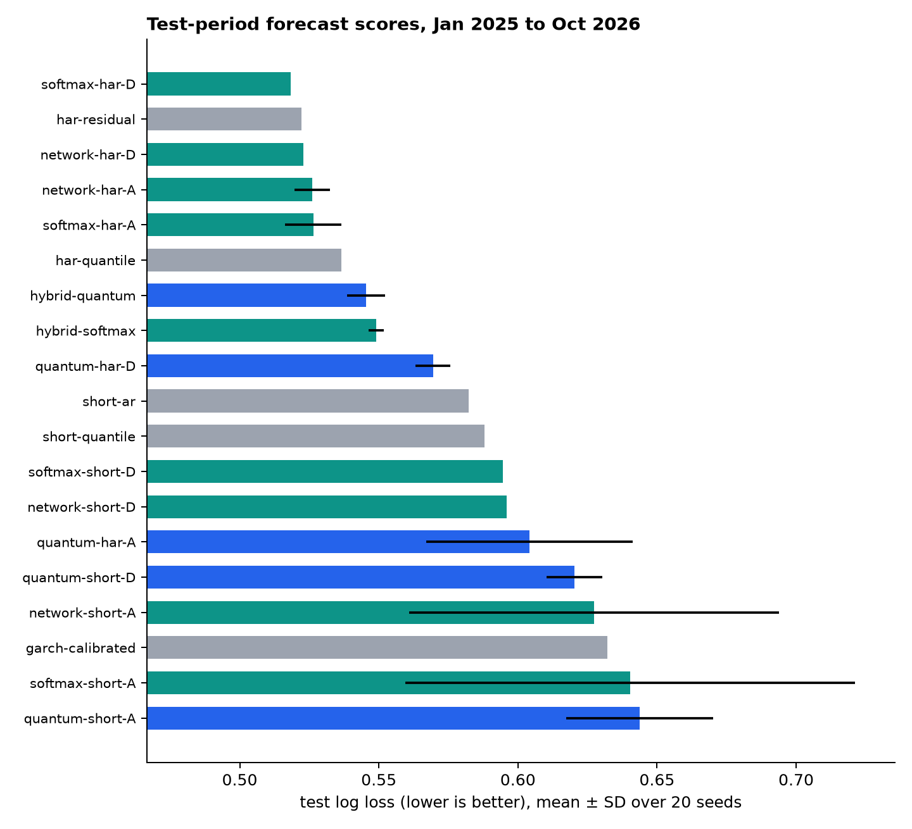
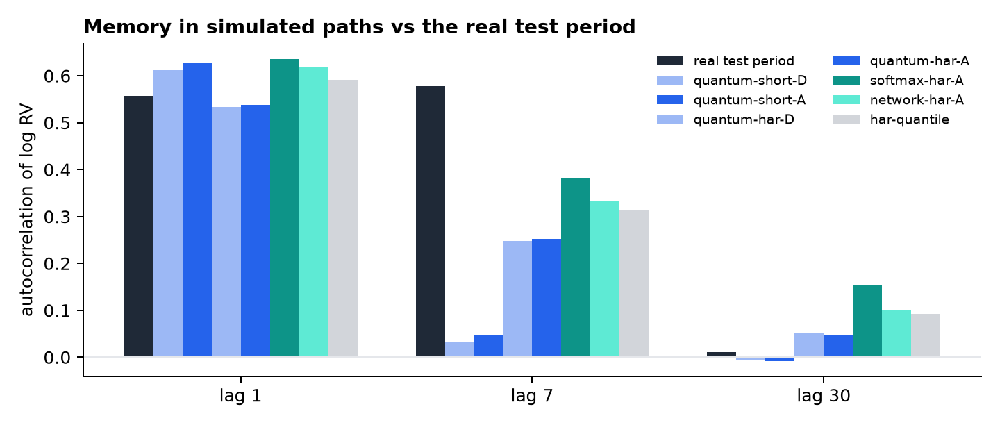

# Fresh-data study: measured results

Executed 20 October 2026 under the [pre-committed protocol](fresh-study-protocol.md) (one
amendment, made during development and before any test score). Training was sealed in commit
`3dfacc2` (`doc/fresh-study-results/seal.json`) **before** the test period was scored once.
Full tables: [tables.md](fresh-study-results/tables.md); machine-readable summary:
[results.json](fresh-study-results/results.json).

Data: Bitstamp BTC/USD daily realized variance from 5-minute returns. Train 2016-12-31 to
2022-12-31 (2,192 days), validation 2023-2024 (731), **test 2025-01-01 to 2026-10-19
(657 days)**, which no earlier project study used. The paper's own data turns out to be
Bitstamp 2020-08-30 to 2023-02-28 (correlation 0.9998 with our series).

## Main findings

1. **Memory (B) clearly helps.** With the same circuit, adding weekly and monthly inputs
   lowers test log loss by **0.051** (95% date-bootstrap interval −0.071 to −0.030, both
   block lengths). The same holds for every classical model (softmax 0.594 → 0.518,
   network 0.596 → 0.523). This reverses the earlier "no memory benefit" decision, which
   was made on the one-qubit point model with mean squared error on 913 days.
2. **Realism training (A) now does what it is for, at a forecast cost.** With memory and
   same-length targets, A improved the realism of simulated paths on the unseen test period
   for every model family: quantum 33.5 → 29.0, softmax 19.2 → 16.8, network 24.5 → 18.4
   (mean distance to the real test moments; better in 15, 16 and 18 of 20 seeds). In the
   earlier study A made realism *worse* (19.7 → 31.9). But A also worsened test log loss:
   quantum +0.035 (interval +0.023 to +0.045), softmax +0.008 (+0.001 to +0.016), network
   +0.003 (interval includes zero). It is a trade-off, not a free improvement.
3. **No quantum advantage.** The best quantum forecaster (quantum-har D, 0.570) is behind
   the same-input softmax (0.518, difference +0.051, interval excludes zero), the network
   (0.523) and HAR quantile (0.537). The quantum A model is behind the classical A models
   by 0.078.
4. **Adding an expert on top of HAR did not help on test, quantum or classical.** Both
   hybrids were slightly *worse* than HAR quantile alone (quantum +0.009, classical +0.012,
   intervals exclude zero), although they were better on validation. The quantum and
   classical hybrids are indistinguishable (−0.004, interval −0.011 to +0.003).
5. **Best model overall: plain softmax regression on HAR inputs (0.518)**, narrowly ahead of
   the HAR residual model (0.522).

## Forecast scorecard (test, mean ± SD over 20 training seeds)

| Model | Test log loss ↓ | Test realism distance ↓ |
| --- | ---: | ---: |
| softmax-har-D | 0.5184 | 19.23 ± 1.24 |
| har-residual | 0.5221 | 18.37 ± 1.22 |
| network-har-D | 0.5228 | 24.45 ± 1.87 |
| network-har-A | 0.5262 ± 0.0064 | 18.38 ± 3.36 |
| softmax-har-A | 0.5264 ± 0.0102 | 16.82 ± 2.04 |
| har-quantile | 0.5366 | 20.92 ± 1.77 |
| hybrid-quantum | 0.5454 ± 0.0068 | 24.76 ± 1.80 |
| hybrid-softmax | 0.5490 ± 0.0027 | 24.58 ± 2.97 |
| quantum-har-D | 0.5695 ± 0.0063 | 33.50 ± 3.21 |
| quantum-har-A | 0.6042 ± 0.0371 | 29.00 ± 6.28 |
| quantum-short-D | 0.6204 ± 0.0100 | 72.34 ± 3.14 |
| garch-calibrated | 0.6321 | 38.19 ± 1.54 |

Short-input classical models, their A versions and the frequency baseline are in
[tables.md](fresh-study-results/tables.md). Deterministic models show no seed SD; their
realism SD comes from the simulation streams.

## Selected settings (validation only, frozen before training)

| Model | Circuit depth | Realism weight chosen | Weight used for A |
| --- | ---: | ---: | ---: |
| quantum-har | 3 | 0.05 | 0.05 |
| softmax-har / network-har | – | 0.01 / 0.01 | 0.01 / 0.01 |
| quantum-short | 3 | 0 (keep D) | 0.01 |
| softmax-short / network-short | – | 1.0 / 0.2 | 1.0 / 0.2 |
| hybrid-quantum | 2 | – | – |

With memory, validation preferred realism training for all three families; for the
yesterday-only circuit it preferred plain D, matching the earlier study. Both quantum depth
choices hit the top of the fixed grid (1-3).

## Why the test period is hard: a calmer market

| Period | Median annualized volatility | Calm days | Extreme days |
| --- | ---: | ---: | ---: |
| Train | 63% | 30% | 5% |
| Validation | 41% | 67% | 0.1% |
| Test | 37% | 75% | **0** |

The four levels are fixed from training data, so the test period had **no extreme days at
all**. Extreme-level Brier scores are therefore nearly zero for every model and carry no
information about tail risk; they are not interpreted. Realism targets learned from training
(30-day autocorrelation 0.25 in same-length training windows) differ from the test period's
(0.01), which limits how much any realism training can help on test.

The test period also has a strong **weekend effect**: mean log RV is about −7.6 on weekdays
and −9.0 on Saturdays. That is why its 7-day autocorrelation (0.58) exceeds its 1-day value
(0.56). No model here sees the day of the week, so every model under-produces weekly
autocorrelation (0.25 to 0.38). Adding a weekday input is the clearest next improvement.

## Checks and provenance

- 155 of 160 forecast fits pass the optimizer and independent central-difference gradient
  checks; all 120 realism fits terminate normally. The 5 misses are classical hybrid fits with
  gradients 2.5e-4 to 1.4e-3 (tolerance 1e-4); they stay in all scores.
- Seal: 30 training artifacts and the package source hashed; evaluation verified the seal
  before reading any test row. The seal commit precedes the evaluation.
- Independent recomputation of quantum-har D and softmax-har D test log loss from saved
  parameters, using the original `BornCircuit` and a separate softmax, matches to 1e-6;
  bootstrap mean differences recomputed from the saved daily losses match.
- `FastBorn` equals `BornCircuit` to 1e-12 (tests, depths 1-4); the Qiskit circuit in
  `scripts/run_ibm_hardware.py` matches to 9e-16 including bit order.
- Evaluation ran in about 3 minutes; development and final training about 2.5 hours on
  2 CPU cores.

## Limits

- One market and one test period of 657 days, in a calmer regime than training. Twenty seeds
  measure training variability, not twenty markets.
- Selection used two development seeds; quantum depth was capped at 3 by the protocol.
- Model information and capacity differ (quantum-har: 24 parameters; softmax-har: 20;
  network-har: 24; HAR models are fitted in closed form or by linear programming).
- The realism distance uses four moments only; tails and multifractal measures were not
  targets.
- Bitstamp alone; the daily file is derived from a community mirror of exchange data.
- Hardware runs (IBM) were not performed here; the script is ready for a local run.

## What this means for the project

**Follow-up: versus the paper's own model.** On the same data and test days, our quantum
model beats the paper's exact 1-qubit model on range forecasts (log loss 0.570 vs 1.196),
point forecasts (QLIKE 0.504 vs 0.840) and realism (distance 33.5 vs 215.3), with every
bootstrap interval below zero. See [paper-comparison.md](paper-comparison.md).

The project's three ideas now have clean evidence. **B (memory) works.** **A (realism
training) works for realism when combined with memory and correct targets, but costs some
forecast accuracy.** **D (range forecasts) works as a framework, but the quantum circuit
inside it does not beat simple classical models of similar size**, either alone or added on
top of HAR. These results, together with the paper audit (one redundant parameter, exact
classical formula, no memory), are a defensible and honest contribution.
