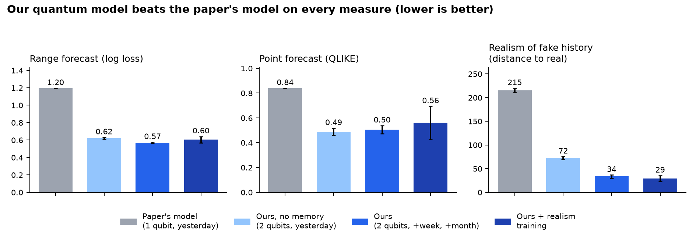

# Our quantum model versus the paper's model: measured results

Run 20 October 2026 under the [pre-committed protocol](paper-comparison-protocol.md)
(commit `e5e8ce4`, made before the paper model was fitted on this data). Same Bitstamp
data, same training years (2017-2022), same 657 unseen test days (2025-01-01 to
2026-10-19), 20 seeds each. Our models are the sealed ones from the
[fresh study](fresh-study.md); the seal was verified before computing anything.

## Result: our quantum model is better than the paper's on every measure

| Model | Range forecast: log loss ↓ | Point forecast: QLIKE ↓ | Squared error ↓ | Fake-history realism: distance ↓ |
| --- | ---: | ---: | ---: | ---: |
| **Paper** (1 qubit, yesterday, one number) | 1.196 | 0.840 | 1.62e-6 | 215.3 |
| Ours, no memory (2 qubits, yesterday) | 0.620 | 0.489 | 0.62e-6 | 72.3 |
| **Ours** (2 qubits, + week, + month) | **0.570** | 0.504 | 0.65e-6 | 33.5 |
| Ours + realism training | 0.604 | 0.560 | 1.03e-6 | **29.0** |

Paired date-bootstrap intervals (95%, 30-day blocks; the 7-day intervals are narrower), ours minus paper:

| Comparison | Log loss | QLIKE | Squared error |
| --- | --- | --- | --- |
| Ours − paper | −0.63 [−0.77, −0.48] | −0.34 [−0.40, −0.27] | −0.98e-6 [−1.17e-6, −0.78e-6] |
| Ours + realism − paper | −0.59 [−0.73, −0.44] | −0.28 [−0.33, −0.23] | −0.59e-6 [−0.80e-6, −0.37e-6] |

Every interval is entirely below zero: the improvement is not a lucky stretch of dates.
All 20 paper fits pass their optimizer and gradient checks.

## Fake-history memory (autocorrelation of log volatility)

| | 1 day | 7 days | 30 days |
| --- | ---: | ---: | ---: |
| Real test period | 0.557 | 0.578 | 0.011 |
| Paper's model | 0.070 | −0.002 | −0.004 |
| Ours, no memory | 0.612 | 0.032 | −0.007 |
| Ours | 0.534 | 0.247 | 0.051 |
| Ours + realism training | 0.538 | 0.252 | 0.048 |

The paper's fake histories have essentially no memory, even from one day to the next.

## Why the paper's model struggles

1. **Input scaling.** The paper divides inputs by 1.2 × the largest value in its data
   (the author's published data peaks at 0.833 = 1/1.2). Our training years contain the
   March 2020 crash, so an ordinary day becomes a tiny input (test median 0.003). The circuit
   barely tells days apart: for seed 0, its test forecasts correlate only 0.22 with actual
   volatility and average 0.0016 against an actual 0.00054, about three times too high for the calm
   2025-26 market. Our models use log volatility standardized on training data, so one
   extreme crash does not squash every other day.
2. **One day of memory.** The paper only sees yesterday. Adding the 7- and 30-day averages
   improves our circuit's log loss by 0.051 (fresh study) and halves the realism distance
   (72 → 34).
3. **One number instead of a range.** The paper outputs a single probability used as next
   day's volatility; its fake histories get their randomness from a classical Gaussian, not
   from the qubit. Our circuit outputs four probabilities, and measuring it picks each fake
   day's volatility level.

## What can and cannot be claimed

* **Can claim:** on the same data and the same unseen test days, our quantum model forecasts
  volatility better (point and range) and generates far more realistic histories than the
  paper's quantum model, with the gap well outside date-sampling uncertainty.
* **Step-by-step attribution is partial.** The step from the paper to "ours, no memory"
  changes several things at once (1 → 2 qubits, log standardized inputs, four-level output,
  depth 3, log-loss training), so it cannot be split between them. The step from
  "no memory" to "ours" changes only the memory inputs, so that gain is attributable to
  memory.
* **Point forecasts:** adding memory did not improve QLIKE (0.489 → 0.504); its gain shows
  in range forecasts and realism.
* **Not claimed:** quantum advantage. Classical models with the same inputs remain better
  (softmax-har: log loss 0.518, QLIKE 0.302), as reported in the fresh study.
* This comparison was planned after the main study's test scores were seen. The paper model
  has nothing to tune and our models were not changed, so no choice was made using test
  results; the protocol was still committed before the paper model was run.
