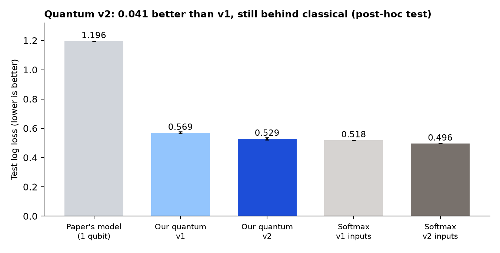

# Quantum v2: measured results (post-hoc test)

Run 20 October 2026 under the [v2 protocol](v2-protocol.md) (committed before training).
Training was sealed in commit `0499e39` before the test period was scored once. The weekend
idea came from looking at the already-scored test period, so **these test numbers are
post-hoc**; a new market (Ethereum) is the planned clean check.
Machine-readable: [v2-evaluation.json](fresh-study-results/v2-evaluation.json).

## What changed from v1

1. Every rotation angle uses **all inputs, on both qubits** (in v1, qubit 1 never saw
   yesterday's volatility).
2. Inputs are **squashed** with 2·tanh(x/2), so very calm or very wild days do not push the
   circuit's sine waves into regions it never saw in training.
3. Two **calendar flags** for the forecast day: weekend and Monday.
4. Small ridge penalty (0.001). Depth 3, 84 parameters, exact gradients (JAX).

All choices were made on 2023-2024 validation data.

## Test results (657 days, 2025-01-01 to 2026-10-19; mean ± SD over 20 seeds)

| Model | Params | Log loss ↓ | Brier ↓ | QLIKE ↓ |
| --- | ---: | ---: | ---: | ---: |
| Paper's model (1 qubit) | 3 | 1.196 | – | 0.840 |
| Our quantum v1 (quantum-har D) | 24 | 0.570 ± 0.006 | 0.313 | 0.504 |
| Quantum v2 without calendar | 84 | 0.556 ± 0.009 | 0.307 | 0.445 |
| **Quantum v2** | 84 | **0.529 ± 0.008** | 0.292 | 0.449 |
| Softmax, v1 inputs | 20 | 0.518 | 0.299 | 0.302 |
| Network, v2 inputs | 26 | 0.504 | 0.287 | 0.336 |
| Softmax, v2 inputs | 28 | 0.496 | 0.288 | 0.289 |

**Effective parameters (added 22 Oct 2026):** "Params" counts nominal parameters. A Jacobian
rank check ([ADR 021](architecture.md)) shows the final-layer RZ weights of quantum v2
cannot affect its probabilities: 84 → 70 effective (60 → 50 without calendar). The classical
models also have redundant directions: softmax-v2 28 → 21, network-v2 26 → 23. Scores are
unchanged; `qcvol_next.trimmed_v2` is the 70-parameter form for future runs.

Paired date-bootstrap intervals (95%, 30-day blocks; 7-day blocks give the same
conclusions), left minus right, negative favors quantum v2:

| Contrast | Log loss | Brier | QLIKE |
| --- | --- | --- | --- |
| v2 − v1 | **−0.041** [−0.059, −0.021] | −0.021 [−0.031, −0.011] | −0.056 [−0.076, −0.036] |
| v2 − v2 without calendar | **−0.027** [−0.040, −0.014] | −0.016 [−0.024, −0.008] | +0.004 [−0.005, +0.013] |
| v2 − softmax v2 | +0.033 [+0.023, +0.043] | +0.004 [−0.000, +0.008] | +0.160 [+0.114, +0.206] |
| v2 − network v2 | +0.025 [+0.015, +0.035] | +0.004 [−0.000, +0.009] | +0.113 [+0.075, +0.150] |

## What this means

* **v2 is a real improvement of our quantum model**: better than v1 on every measure, with
  intervals well below zero. About a third of the gain is the new encoding (v1 0.570 → v2
  without calendar 0.556) and two thirds is the weekend input (0.556 → 0.529).
* **The gap to classical shrank but did not close.** v1 trailed same-input softmax by 0.051;
  v2 trails by 0.033, with 3× the parameters. On Brier score the gap is now within noise
  (+0.004, interval touches zero). On QLIKE (point forecasts), classical is clearly better.
* **No quantum advantage**, as before. v2 is now ahead of the v1 *classical* softmax on Brier
  (0.292 vs 0.299), but that comparison gives the classical model fewer inputs and is not a
  fair test.

## Checks

* All 20 quantum v2 fits (and 20 without calendar) pass the optimizer and gradient checks;
  softmax 20/20; network 11/20 (the other 9 reach the same training loss 0.8152 with
  gradients slightly above 1e-4; kept, as in the main study).
* Tests: the fast JAX circuit equals a plain 4×4 statevector simulation to 1e-12; JAX
  gradients equal finite differences; calendar flags use the forecast day's weekday.
* The fresh-study seal and the v2 seal are both verified before any test row is read.

## Limits

* Post-hoc on this test period (disclosed above). Weekend size changed over time
  (−0.4 in training years, −1.2 validation, −1.4 test), which favors any model with a
  weekend input on this test.
* Realism of generated paths is not evaluated for v2 (the generator has no calendar yet).
* One market.
