# Abstract

Prices of cryptocurrencies like Bitcoin swing a lot, and those swings come in waves: a calm day is usually followed by another calm day, and a wild day by more wild days. The size of these swings is called **volatility**. Predicting tomorrow's volatility is useful for managing risk.

A 2026 research paper by T. Takaishi showed that a **one-qubit quantum circuit** (simulated on a normal computer) can be trained to predict Bitcoin's next-day volatility. Our project started by **rebuilding that model exactly** and then tried to make it better in three ways:

- **More memory:** let the model look at the last day, the last week and the last month, not just yesterday.
- **A range instead of one number:** use **two qubits** so the model gives the chance that tomorrow is *calm*, *normal*, *wild* or *extreme*.
- **More realistic behaviour:** train it so that the price histories it imagines look like real ones.

We tested everything fairly: each model is trained on old data, tuned on newer data, and judged only once on the most recent data it has never seen. Every quantum model was compared with an ordinary (classical) model given **exactly the same inputs**.

::: key
**Main findings.** (1) Our two-qubit model is much better than the original paper's model on fresh Bitcoin data (score 0.5695 vs 1.196, lower is better). (2) Giving the model a week and a month of memory clearly helps. (3) However, simple classical models with the same inputs were still as good or better in almost every test, including across ten different cryptocurrencies. **We therefore do not claim any quantum advantage.** All quantum circuits were run on a simulator; no real quantum computer was used.
:::

# Introduction

## Background

**What is volatility?** If Bitcoin moves 0.5% in a day, that day was calm; if it moves 8%, it was wild. We measure each day's volatility using **realized volatility (RV)**: take the price change over every few minutes during the day, square each change, and add them up:

$$\text{RV}_t = \sum_{i=1}^{n} r_{t,i}^2$$

where $r_{t,i}$ is the $i$-th small price change (log return) on day $t$. A bigger RV means a wilder day.

**Why is it predictable at all?** Volatility has *memory*: wild weeks cluster together. A well-known classical model called **HAR** (Corsi, 2009) uses exactly this. It predicts tomorrow from the average of yesterday, the last 7 days and the last 30 days.

**What is quantum circuit learning?** A qubit is the quantum version of a bit. Instead of being just 0 or 1, it holds a *probability* of being measured as 0 or 1. A quantum circuit rotates qubits by angles. In **quantum circuit learning** (Mitarai et al., 2018), we put our data into some of these angles, leave other angles as adjustable "knobs", and let a normal computer tune the knobs until the circuit's output matches the data, very much like training a small neural network.

## Problem statement

The original paper's model has four weaknesses:

1. It only sees **yesterday**, so it cannot use the weekly or monthly patterns we know exist.
2. It outputs **one number**, not how likely a calm or extreme day is.
3. It is trained to predict one day ahead, but judged on whether the long histories it generates look realistic.
4. It is trained and judged on the **same data**, so we cannot tell how well it would work on new days.

## Objectives

1. Rebuild the paper's one-qubit model and check that we get the same results.
2. Add memory, range forecasts and realism-aware training.
3. Compare every quantum model with a classical model that gets the same inputs.
4. Check whether any improvement holds up on fresh data and on other cryptocurrencies.

## Scope

We study daily volatility of Bitcoin (the paper's own data, plus fresh Bitstamp data up to 19 October 2026) and nine more coins from Binance (ETH, SOL, DOGE, LTC, BNB, ADA, LINK, DOT, AVAX). Quantum circuits are run on an exact simulator on ordinary CPUs. A script to run on an IBM quantum computer exists but **was not run**, so we make no claims about real quantum hardware or speed.

# Literature Review

| Work | What it did | Limitation for our purpose |
|---|---|---|
| Mitarai et al. (2018) | Introduced quantum circuit learning | General method, not about finance |
| Pérez-Salinas et al. (2020) | Showed that feeding the data into a small circuit several times ("re-uploading") makes it much more powerful | Classification, not forecasting |
| Corsi (2009), HAR model | Simple classical model using day/week/month averages; still a strong benchmark | Gives one number only |
| Takaishi (2025) | One-qubit circuit on simulated volatility data | Synthetic data only |
| Takaishi (2026), **our base paper** | One-qubit circuit on real Bitcoin volatility; checked the "multifractal" shape of generated series | One day of memory; one number; no held-out test; no matched classical comparison |
| Schreiber et al. (2022); Bowles, Ahmed and Schuld (2024) | Showed many small quantum models can be copied or beaten by classical models, and called for fair benchmarks | Motivates our same-input classical controls |
| Li et al. (2025) | Quantum reservoir computing for volatility | Different model type |

Table: Related work and its limitations

::: key
**Gap we address.** No earlier quantum volatility study combined (a) multi-day memory, (b) a probability range output, (c) a strict train/validate/test split, and (d) classical models with identical inputs as the comparison.
:::

# Novelty

Our work is based on **T. Takaishi, "Quantum Circuit Learning for Volatility Modeling: Multifractal Analysis of Realized Volatility Time Series", *Fractal and Fractional* 10(7):442, 2026 [1]**. What we did differently:

| Original paper | Our project |
|---|---|
| 1 qubit | 2 qubits connected by a CNOT gate |
| Input: yesterday only | Input: yesterday, 7-day average, 30-day average and return |
| Output: one number | Output: probability of 4 levels (calm, normal, wild, extreme) |
| Trained on squared error | Trained on log loss, optionally plus a realism penalty |
| Same data for training and judging | Train / validation / test split in time order |
| No same-size classical comparison | Classical "twins" with identical inputs and output |
| One dataset | Fresh Bitstamp data and 10 Binance coins, 20 random seeds each |
| No pass/fail rule | Pass/fail rules written down **before** looking at test results |

Table: Original paper vs our project

# Methodology and System Design

## Overall pipeline

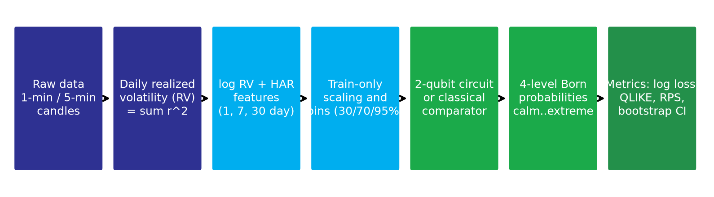{width=100%}

1. **Raw data:** prices every 1 or 5 minutes.
2. **Daily RV:** squared small returns added up for each day (equation above). We work with $\log(\text{RV})$ because it is better behaved.
3. **Memory features:** for each day we compute yesterday's value, the 7-day average, the 30-day average, and yesterday's return. The first 30 days are dropped because they lack a full month of history.
4. **Scaling:** features are rescaled using statistics from the training period only, so no future information leaks in.
5. **Model:** the quantum circuit (or a classical model) turns the features into four probabilities.
6. **Score:** we compare the probabilities with what actually happened.

## The four volatility levels

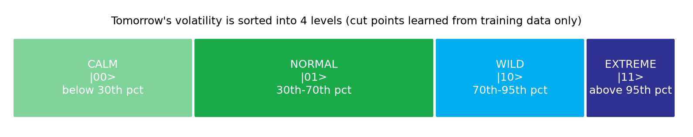{width=100%}

Using the training data, we find the 30th, 70th and 95th percentile of $\log(\text{RV})$. These cut points define four levels. Two qubits have exactly four possible measurement outcomes ($|00\rangle, |01\rangle, |10\rangle, |11\rangle$), so each outcome naturally represents one level.

## Original model (paper)

The paper's single qubit receives yesterday's return $r$ and variance $\sigma^2$ as rotation angles, then one trainable rotation $U_3(\theta,\phi,\lambda)$. The probability of measuring 0 is used directly as the forecast. We verified our rebuild against the paper's closed-form formula $P(0) = \tfrac12 + \tfrac12\,\mathbf{n}\cdot\mathbf{b}$.

## Our two-qubit circuit

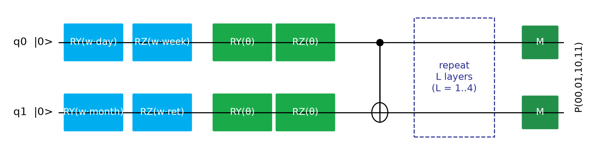{width=100%}

- **Load data (blue):** qubit 0 gets yesterday and the weekly average; qubit 1 gets the monthly average and the return. Each is multiplied by a trainable weight $w$.
- **Trainable rotations (green):** each qubit gets an adjustable $R_Y$ and $R_Z$ rotation.
- **CNOT:** links the two qubits so they can share information.
- **Repeat:** the whole layer is repeated $L$ times (we tried 1 to 4; 3 layers = 24 parameters). Loading the data again in every layer is the "re-uploading" trick.
- **Measure:** the probabilities of the four outcomes are the forecast.

The probability of each outcome comes from the quantum state $|\psi\rangle$ (the Born rule):

$$p_k = |\langle k \,|\, \psi(\mathbf{x};\boldsymbol{\theta})\rangle|^2,\qquad k \in \{00, 01, 10, 11\}$$

Later versions (v2 and v3) added a classical HAR term to the circuit's output and used more training restarts. Our multi-coin version uses only $R_Y$ gates plus a HAR term, with a single "temperature" setting that makes the probabilities slightly more or less confident.

## How the model is scored

**Log loss** (main score, lower is better). If the model gave probability $p_{\text{true},t}$ to the level that actually happened on day $t$:

$$\text{Log loss} = -\frac{1}{N}\sum_{t=1}^{N} \log p_{\text{true},t}$$

A model that puts high probability on what really happens gets a low score. A model that is confidently wrong is punished heavily.

Other checks: **QLIKE** (a standard error score for volatility), how realistic generated histories look (their correlation with the past at 1, 7 and 30 days), and calibration (does "30% chance" happen about 30% of the time).

## Making the comparison fair

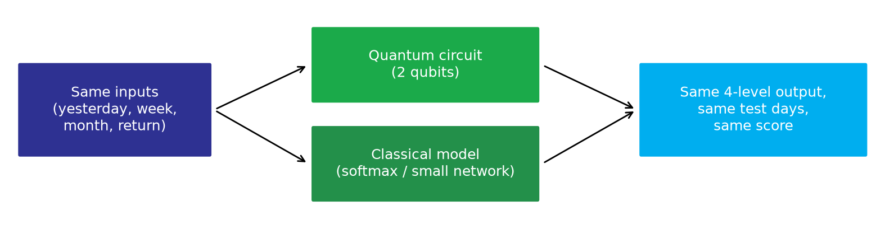{width=95%}

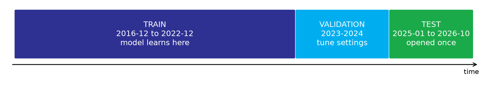{width=100%}

- **20 seeds:** each model is trained 20 times from different random starting points; we report the average.
- **Confidence intervals:** we resample blocks of 7 or 30 consecutive test days (bootstrap) to see whether a difference could just be luck. If the interval includes zero, the difference is **not** convincing.
- **Rules written in advance:** for the multi-coin studies we decided beforehand that the quantum model must beat the best classical model by **at least 5%** in log loss, with an interval that excludes zero, on all coins in the group.
- **Sealed results:** trained models were saved and fingerprinted (hashed) before test scoring, so they could not be changed afterwards.

# Implementation

## Tools

| Item | Details |
|---|---|
| Language | Python 3.12, managed with `uv` |
| Main libraries | NumPy, SciPy (optimisation) |
| Extra libraries | JAX (faster quantum versions), `arch` (GARCH model), matplotlib (plots) |
| Quantum simulator | Our own exact simulator written in NumPy (no noise) |
| Optimisers | L-BFGS-B and COBYLA from SciPy |
| Testing | 109 automated tests (pytest) plus Ruff style checks |
| Hardware | Ordinary laptops (CPU only) |

Table: Software and tools

## Datasets

| Dataset | Source | Period and size |
|---|---|---|
| Paper's Bitcoin data | Author's public repository | 913 days (Aug 2020 to Feb 2023); split 529 / 177 / 177 |
| Fresh Bitcoin (Bitstamp) | 1-minute prices | Dec 2016 to 19 Oct 2026; train 2,192 days, validation 731, test 657 |
| 10 Binance coins | 5-minute prices, checksum-verified | Up to 19 Oct 2026; same 657-day test period (from 2025-01-01) |

Table: Datasets used

## Code organisation

- `qvol/`: the rebuild of the original paper, with five experiment scripts.
- `src/qcvol/`: our main pipeline: data, quantum simulator, classical models, training, scoring.
- `src/qcvol_v2/`, `src/qcvol_v3/`: improved quantum versions.
- `src/qcvol_next/`: Binance data and the multi-coin models.
- `scripts/`: data builders, study runners, checkers and plotting.
- `doc/`: a written plan (protocol) and a results note for every study.

## Development steps

1. Rebuild and check the paper's model.
2. Build the two-qubit model and the classical comparators on the paper's data.
3. Run a frozen 20-seed comparison.
4. Repeat on fresh Bitstamp data.
5. Improve the circuit (v2, v3).
6. Write rules in advance, then test on ten Binance coins.

# Results and Discussion

## Step 1: Rebuilding the paper

We reproduced the paper's model on its own data: fitted angles $\theta = -4.557$, $\phi = 0.360$, $\lambda = 1.700$; training error (MSE) 0.00205; correlation between forecast and real value 0.449. We also found that the angle $\phi$ has **no effect** on the output, and confirmed the model only uses one day of history.

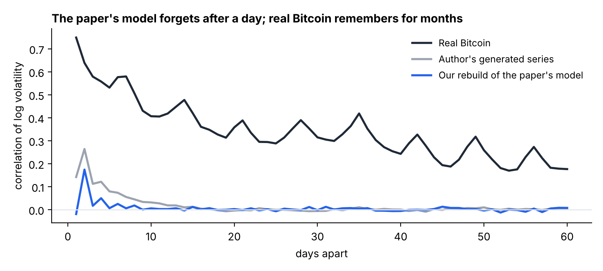{width=80%}

## Step 2: 20-seed study on the paper's data

| Model | Test log loss (lower is better) |
|---|---|
| HAR quantile (classical) | **0.5289** |
| HAR residual (classical) | 0.5295 |
| Small network (classical) | 0.5784 |
| Softmax (classical) | 0.5822 |
| Quantum, range forecast | 0.6920 |
| Quantum, with realism training | 0.8623 |

Table: Step 2: 20-seed test results on the paper's data

::: key
On the paper's data, **classical models won**. Adding realism training made the quantum model's forecasts worse, and on the test data its generated histories were also less realistic (moment distance 19.72 rose to 31.86).
:::

## Step 3: Fresh Bitcoin data and the original paper

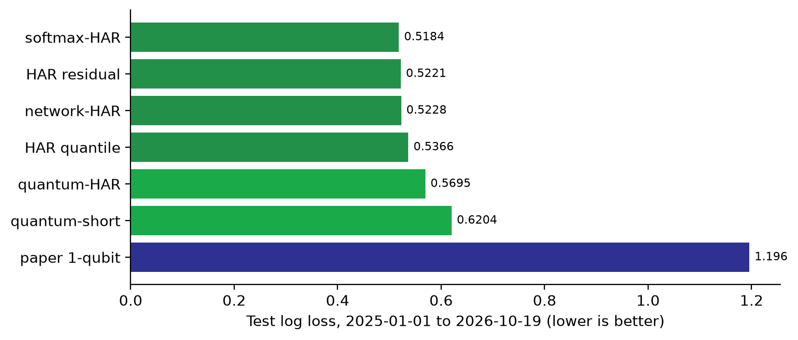{width=85%}

| Measure (lower is better) | Original paper | Our quantum model |
|---|---|---|
| Log loss | 1.196 | **0.5695** |
| QLIKE | 0.840 | **0.504** |
| Realism distance | 215.3 | **33.5** |

Table: Step 3: original paper model vs our quantum model (fresh Bitcoin test)

::: key
**Our upgrade clearly beats the original paper model** on every measure, and all confidence intervals exclude zero. **Memory helps:** adding weekly and monthly averages improved log loss by 0.051 (interval −0.071 to −0.030). **But** the classical softmax model with the same inputs scored 0.5184, better than our quantum model. (This paper comparison was planned after we had already seen the main test results.)
:::

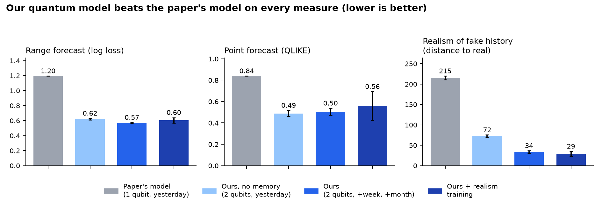{width=80%}

## Step 4: Improved circuits (v2 and v3)

| Model | Test log loss |
|---|---|
| Quantum v1 | 0.5695 |
| Quantum v2 | 0.529 |
| Quantum v3 | 0.5145 |
| Classical softmax with v2 inputs | **0.4962** |

Table: Step 4: quantum circuit versions vs matching classical model

Each new quantum version was better than the last, but the matching classical model still won by 0.018. These were tested on a period we had already looked at, so they are only indicative.

## Step 5: Ten cryptocurrencies

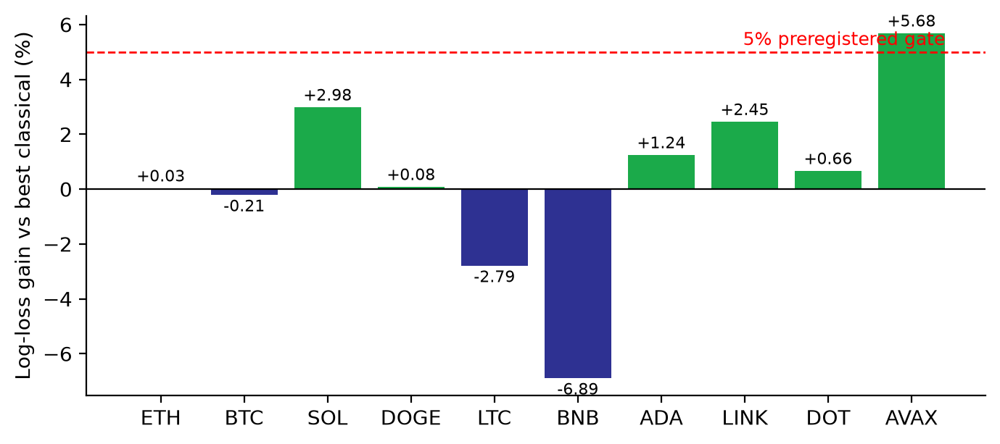{width=85%}

| Coin | Quantum log loss | Best classical | Quantum gain | Passed 5% rule? |
|---|---|---|---|---|
| ETH | 0.6480 | 0.6482 | +0.03% | No |
| BTC | 0.5320 | 0.5309 | −0.21% | No |
| SOL | 0.4050 | 0.4174 | +2.98% | No |
| DOGE | 0.7627 | 0.7633 | +0.08% | No |
| LTC | 0.6132 | 0.5966 | −2.79% | No |
| BNB | 0.3918 | 0.3666 | −6.89% | No |
| ADA | 0.7602 | 0.7698 | +1.24% | No |
| LINK | 0.5771 | 0.5916 | +2.45% | No |
| DOT | 0.6387 | 0.6430 | +0.66% | No |
| AVAX | 0.4485 | 0.4755 | **+5.68%** | Alone yes, group no |

Table: Step 5: quantum vs best classical model on ten coins (test log loss)

::: key
**No coin group passed the rule written in advance.** AVAX was the only coin above 5%, but its group (LINK, DOT, AVAX) failed together, and on the QLIKE score the quantum model was worse on all three.
:::

## What this means

- The big jump over the original paper came from **better inputs (memory)** and **a better output (four probabilities)**, not from anything uniquely quantum: classical models given the same things do as well or better.
- Realism training made forecasts worse in our tests.
- Small quantum circuits like ours behave much like small classical models, which matches warnings in recent research (Schreiber et al., 2022; Bowles et al., 2024).

# Conclusion and Future Work

## What we achieved

- A checked rebuild of the Takaishi one-qubit model.
- A two-qubit range forecaster with memory that **clearly beats the original model** on fresh data.
- A fair testing setup: time-ordered splits, classical twins, 20 seeds, rules written in advance, sealed results.
- Tests on ten cryptocurrencies, plus 109 automated code tests.

## Limitations

- **Simulator only:** no real quantum computer was used, and no noise was modelled.
- **Reused test period:** v2, v3 and some later studies use the same 2025-2026 test days, so their results are only indicative.
- **Seeds are not markets:** 20 seeds show training variation, not 20 independent experiments.
- **Optimiser limits:** training stopped at a fixed budget, which does not prove the best settings were found.
- **Data limits:** the paper's data is pre-scaled (no real units), and the fresh Bitcoin test period had no "extreme" days.

## Future work

- Test our most promising Bitcoin setting (a 3-layer $R_Y$ circuit that was 2.39% better than the network on validation data) on truly new data.
- Run on IBM quantum hardware and study the effect of noise.
- Add formal forecast comparison tests (Diebold–Mariano).
- Try other quantum approaches such as quantum reservoirs or generative "Born machines".

# Contributions

| Member | Responsibilities and tasks |
|---|---|
| **Srimoneyshankar Ajith** (2024BCS0055) | Project coordination; Binance data pipeline with checksum verification; ETH, BTC, SOL and DOGE replication studies and their pre-written rules; $R_Y$ HAR hybrid quantum model; research log |
| **Bharadwaj B Chand** (2024BCS0059) | Checking the paper rebuild and multifractal analysis; memory experiments; realism-training study; classical baselines (HAR, GARCH); verification scripts and comparison figures |
| **Nidhi Rakesh** (2024BCD0006) | Packaging the paper rebuild (`qvol`); quantum v2 models; fresh Bitstamp memory and realism study; paper-vs-ours comparison; sealed results; IBM hardware script |
| **Vishnunath A Suresh** (2024BCS0315) | Literature survey and future-direction research; design of scoring metrics and statistical tests; report and presentation preparation |
| **Gopi Krish** (2024BCS0054) | Code integration and review of pull requests #1 to #12; automated test and style checks; LTC/BNB/ADA and LINK/DOT/AVAX multi-coin studies; result plots |

Table: Team member contributions

# References

1. T. Takaishi, "Quantum Circuit Learning for Volatility Modeling: Multifractal Analysis of Realized Volatility Time Series," *Fractal and Fractional*, vol. 10, no. 7, p. 442, 2026. arXiv:2609.04569.
2. T. Takaishi, "Volatility time series modeling by single-qubit quantum circuit learning," arXiv:2512.10584, 2025.
3. K. Mitarai, M. Negoro, M. Kitagawa, K. Fujii, "Quantum circuit learning," *Phys. Rev. A*, vol. 98, 032309, 2018.
4. A. Pérez-Salinas et al., "Data re-uploading for a universal quantum classifier," *Quantum*, vol. 4, p. 226, 2020.
5. M. Schuld, R. Sweke, J. J. Meyer, "Effect of data encoding on the expressive power of variational quantum machine-learning models," arXiv:2008.08605, 2021.
6. F. J. Schreiber et al., "Classical surrogates for quantum learning models," 2022.
7. J. Bowles, S. Ahmed, M. Schuld, "Better than classical? The subtle art of benchmarking quantum machine learning models," arXiv:2403.07059, 2024.
8. F. Corsi, "A simple approximate long-memory model of realized volatility," *J. Financial Econometrics*, vol. 7, no. 2, 2009.
9. J. Gatheral, T. Jaisson, M. Rosenbaum, "Volatility is rough," *Quantitative Finance*, vol. 18, no. 6, 2018.
10. J. W. Kantelhardt et al., "Multifractal detrended fluctuation analysis of nonstationary time series," *Physica A*, vol. 316, 2002.
11. A. J. Patton, "Volatility forecast comparison using imperfect volatility proxies," *J. Econometrics*, 2011.
12. T. Gneiting, A. E. Raftery, "Strictly proper scoring rules, prediction, and estimation," *J. American Statistical Association*, 2007.
13. F. X. Diebold, R. S. Mariano, "Comparing predictive accuracy," *J. Business & Economic Statistics*, 1995.
14. Q. Li et al., "Quantum reservoir computing for realized volatility forecasting," 2025.

# Appendices

## A. How to run the code

```
uv sync --all-extras
uv run pytest -q
uv run ruff check . && uv run ruff format --check .
uv run python qvol/experiments/01_reproduce_paper.py
```

## B. Glossary

| Term | Plain meaning |
|---|---|
| Volatility | How much the price swings in a day |
| Realized volatility (RV) | Sum of squared small price changes within a day |
| HAR | Classical model using day, week and month averages |
| Qubit | Quantum bit; measured as 0 or 1 with some probability |
| CNOT | Two-qubit gate that flips the second qubit if the first is 1 |
| Log loss | Score for probability forecasts; lower is better |
| QLIKE | Standard error score for volatility forecasts; lower is better |
| Seed | Random starting point for training |
| Bootstrap interval | Range showing how much a result could vary by chance |

Table: Glossary of terms

## C. Additional figures

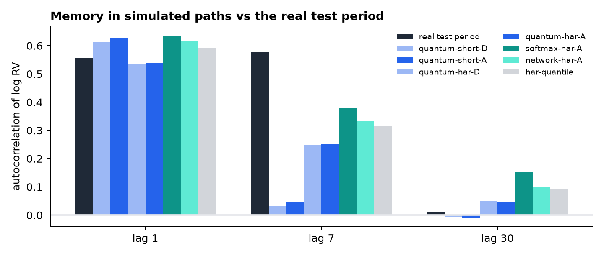{width=75%}

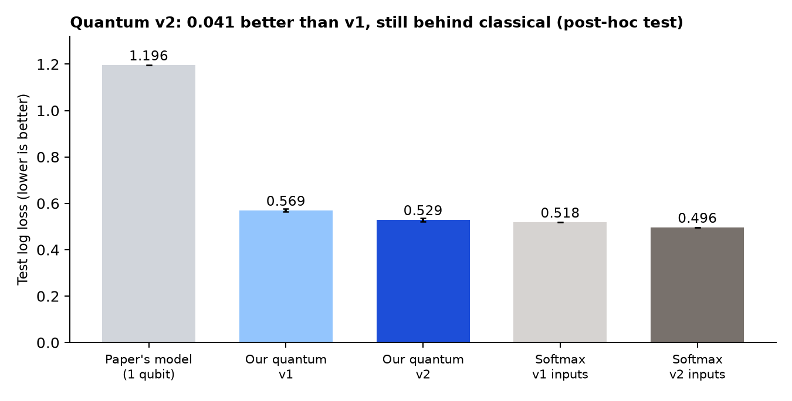{width=75%}

## D. Repository

Full code, written plans and per-study results: `github.com/moneytosms/qcproj` (folder `doc/`).
